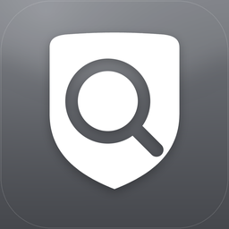

<p align="center">
  
</p>

<h1 align="center">Pwned</h1>

<p align="center">
  A native iOS app for reading vulnerability data and keeping security research notes, with a focus on Apple platforms.
</p>

<p align="center">
  <a href="https://github.com/KammyUnix/pwned/actions/workflows/build.yml"></a>
  <a href="https://github.com/KammyUnix/pwned/actions/workflows/tests.yml"></a>
</p>

Pwned downloads CVE records from the National Vulnerability Database, picks out the ones that concern Apple software, and lets you keep notes that link back to the CVEs, repositories and Apple technologies they mention. Your notes and bookmarks stay on your device.

## Features

- A vulnerability feed for Apple platforms. Records with weak evidence go to a separate list for review instead of being counted as Apple.
- Notes that link themselves to CVE IDs and GitHub repositories, with backlinks on every page they point to.
- A GitHub repository viewer with the README, file tree and text files.
- A catalog of Apple technologies and products, tied to the vulnerabilities, repositories and notes that mention them.
- Offline tools for hashing, number and text conversion, and viewing JSON and property lists.
- Settings for appearance, text size, default filters, history and data use, and an update check on the Info page that reads GitHub Releases.

## Installation

No release has been published yet. When there is one, it will be on the [Releases](https://github.com/KammyUnix/pwned/releases) page as an unsigned IPA. Sign it with your own certificate, or use a sideloading tool that signs it for you.

To build it yourself:

```sh
brew install xcodegen
xcodegen generate
open Pwned.xcodeproj
```

The Xcode project is generated from `project.yml` and is not committed. Choose your own signing team in Xcode before running on a device.

Maintainers can find the release steps in [docs/RELEASING.md](docs/RELEASING.md).

## Requirements

- iOS 26.3 or later
- To build: Xcode 26 and [XcodeGen](https://github.com/yonaskolb/XcodeGen). CI uses Xcode 26.4.1.

## License

There is no license file in this repository yet, so the source code stays under its author's default copyright. GitHub's Terms of Service allow viewing and forking a public repository on GitHub. Anything beyond that needs the developer's permission.

This product uses the NVD API but is not endorsed or certified by the NVD.
